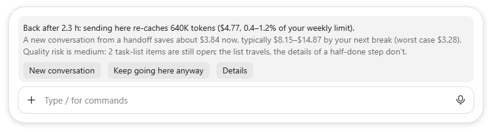

# Claude usage monitor

A local, read-only toolkit for Claude Code, Cowork and Codex usage. It reads the logs they write on your machine,
makes no model calls, changes no settings and sends nothing anywhere. It has three parts:

- **switch-advisor**, a Claude Code plugin: when you come back to a large conversation after its prompt cache
  expired, it tells you whether a new conversation is cheaper than re-sending this one;
- **switch-advisor for Codex**, a Codex plugin that does the same in the Codex app and CLI, through Codex's hooks;
- **the monitor**, a command-line tool in Python: live checks, a replay of your history, handoffs, and the guardrail
  that watches the plugin's switches, for Claude Code and Cowork, and for Codex in `python -m monitor.codex`.

The full design is in [DESIGN.md](DESIGN.md).

## The plugin: switch-advisor



*The band, shown with the example numbers of `/switch-test demo`.*

When you come back to a large conversation after its prompt cache expired, the plugin tells you whether a new conversation, started from a handoff built locally from this one, is cheaper than re-sending this one:

- **The band** (pictured) appears above the prompt by itself once the cache has expired and a switch pays, so it's there when you come back. Its buttons are New conversation, Keep going here anyway and Details. It is never drawn on a phone.
- **The card** asks before your prompt goes out, if you send one without answering the band and a switch still pays with your prompt. A card you close, or don't answer within 2 minutes, sends your prompt as usual.
- **New conversation** leaves this conversation as it is. In the terminal, the next new conversation you start in the same folder within 30 minutes finds the handoff in its box. In the Code tab, paste it into a new session: it's on your clipboard. `/clear` here puts it in this window's box within 24 hours, unless Claude replied here since or a new conversation already took it, and `/switch-test restore` shows it.
- **Only when it pays:** even the worst case has to save at least $0.50, and the typical saving by your next break at least $2 ($5 when the quality risk is medium or high). It stays quiet when Claude Code already prepared its own summary during the break.
- **Quality:** it shows what the handoff might not carry, so you decide.
- **Status line:** in a conversation of about 160K tokens or more, its size and what your next message would cost to re-cache.
- **Estimates checked:** `python -m monitor.verify_estimates` compares its numbers with what really happened in your own sessions. In the author's, the re-cache cost in Code was typically exact (90% of returns within 2%, n=21), and a new conversation's first request typically within 8% (90% within 24%, n=17). In a replay of 6 switches in Code, none saved less than its "save now" figure.

Dollars are API list-price equivalents at the session model's prices: on a subscription they measure how much of
your limits a choice uses, not what you pay. The plugin assumes the 1-hour prompt cache that Claude Code uses on
subscription plans, and shows "% of your weekly limit" only once you set your rate (see Running everything from a
checkout). It makes no model calls, and asks only about prompts you send at the computer: not about slash commands,
ones over Remote Control from your phone, or the app's own continue messages (a message relayed from your phone
through Cowork's Dispatch still looks typed at the computer). Details are in
[mod/switch-advisor/README.md](mod/switch-advisor/README.md) and DESIGN.md §10.6.

### Install

At the prompt of a Claude Code terminal session:

```
/plugin install switch-advisor --marketplace emanuelaviv/claude-usage-monitor
```

Answer `y` to add the marketplace, then pick a scope. From a shell, the same is
`claude plugin install switch-advisor --marketplace emanuelaviv/claude-usage-monitor`. In the desktop app, where
`/plugin` doesn't run: click + next to the prompt box, then Plugins, Add marketplace with
`emanuelaviv/claude-usage-monitor`, then Add plugin. To remove it, run `claude plugin uninstall switch-advisor`, with
`--scope project` or `--scope local` if you picked that scope (or use `/plugin` in a session), and
`claude plugin marketplace remove claude-usage-monitor` to drop the marketplace too.

**In Cowork.** Cowork loads only the plugins in your Claude account, and none of your local settings. To add it to
your account, open Customize › Plugins in the Claude app, choose Add, then either:

- Add marketplace, with `emanuelaviv/claude-usage-monitor`, then add switch-advisor from it;
- or Upload plugin, and pick the file that `python tools/package_plugin.py` builds in `dist/`. To update it, upload
  the new file and choose Replace.

Adding plugins there may be open only to company accounts. If yours doesn't offer it, use the plugin in Claude Code:
the terminal or the desktop app's Code tab.

It can do less in Cowork. New Cowork tasks run in Anthropic's cloud, where nothing a plugin draws appears. A local
task's view doesn't show the band, the status line or toasts either (desktop app 4.23118). And Cowork starts Claude
Code anew for each message, so nothing runs during a break to put the band up. What can work there is the card when
you send. Its New conversation leaves the task as it is: send `/switch-test restore` in it to get the handoff, with
your message, and paste it into a new task. Each task keeps its own plugin store, so a new task can't pick it up by
itself. It has not been tried in Cowork yet: `/switch-test` in a large task shows the card there, and
`/switch-test demo` says whether the band can be drawn. The account's copy loads in the Code tab too; if you also load the plugin from a folder (below), it
steps back in those sessions, so only one copy acts. To remove the account's copy, use Customize › Plugins again: the
commands above don't reach it.

Installed this way, the plugin writes no files of its own and keeps no log. In your project it runs `git status`,
and when a prompt names a `PROMPT_*.md` file, it looks through your project's folder names for that file and reads
it. At the start of each session, it also reads the `.claude-plugin/plugin.json` of each folder that
`CLAUDE_CODE_PLUGIN_DIRS` names, to see whether a folder copy is loaded. New conversation keeps the handoff, your
unsent prompt included, in Claude Code's plugin store, one per conversation. It is deleted the first time the plugin
starts after it is 24 hours old. To get its decision log, the guardrail and your weekly-limit rate, run it from a
checkout instead (see Running everything from a checkout).

**Trying it:** type `/switch-test band` (the band) or `/switch-test` (the card) in a large conversation. The card
shows with that conversation's numbers, as if you were back after a break; **Keep going here anyway** changes
nothing, and **New conversation** keeps a test handoff the way a real switch keeps one, leaving this conversation as
it is. A test never replaces a real handoff from the same conversation, and a new conversation takes a real handoff
before a test's; a `/clear` takes the one its own window made, test or not. `/switch-test demo` shows the band with
example numbers only, for screenshots.

## The Codex plugin: switch-advisor for Codex

Codex lets a plugin run hooks but not draw anything, so this version works when you send a prompt after a break of an
hour or more:

- **When a switch clearly pays**, it holds the prompt back. In the Codex app the prompt stays in the conversation,
  marked "Hook blocked this message", with the numbers below it; in the CLI the numbers show under "Blocked by hook".
  - **To switch:** start a new conversation in the same project folder (in the CLI, `/new` or `/clear`) and send your
    prompt there within 30 minutes. It starts from a handoff built on your computer from the old one. A new worktree
    is another folder, so if `/new` asks, choose Use current Git worktree, and in the app keep the composer on Local.
  - **To stay:** send the prompt again within 15 minutes.
- **Otherwise**, when sending here is expected to cost at least $0.50, a one-line note shows what the message costs if
  the cache expired, and how often it had after breaks that long. Below that, nothing shows. The prompt is sent either
  way.
- **Only a prompt sent from the Codex app's composer or the CLI** can be held back. One from the ChatGPT phone app
  (so far checked only with the Android app), an automation, a retry, an answer in Codex's question panel, an edited
  or queued message, or plan feedback gets the note instead: for most of these, nobody may be there to see the card.

Its economics differ from Claude's:
- Codex's cache has no fixed lifetime, so the plugin uses how often it had expired after breaks of each length.
- A cache miss costs the full input price, with no write premium.
- Codex compacts a conversation by itself near the end of its window.

With the common 272K window, a switch therefore rarely pays. It pays mostly in conversations above 272K tokens, where
every request costs the long-context price. "% of your weekly limit" needs no setup: Codex's logs record the plan's
meter. Details, and what it reads and writes, are in [codex/switch-advisor/README.md](codex/switch-advisor/README.md).

It has not been tried in Codex itself yet: it is tested against Codex's source and with replays of real Codex logs.

In the Codex app, on the Plugins page, choose Add, then Add a marketplace, enter `emanuelaviv/claude-usage-monitor`
as the Source and choose Add marketplace, then add Switch advisor from it. With the Codex CLI:

```
codex plugin marketplace add emanuelaviv/claude-usage-monitor
codex plugin add switch-advisor@claude-usage-monitor
```

Then trust its hooks, and again after each update of the plugin: **Review hooks** in the Codex app's composer, or
Settings > Hooks, or `/hooks` in the CLI. It needs Python 3.10 or later on your PATH: `python` on Windows, `python3`
elsewhere. Send `switch-advisor demo` as a prompt to see the card with example numbers, or `switch-advisor test` to
see it with the conversation's own numbers as if you came back after 3 hours. Once the hooks run, neither goes to the
model, even on an older Python 3, where a message says the plugin needs 3.10 or later. Until you trust the hooks, or
when no Python is found, they go to the model like any other prompt, so try `switch-advisor demo` in a new
conversation before `switch-advisor test` in a large one.

## The monitor (command line)

Every message resends the whole conversation. A large conversation is cheap to resend while its prompt cache is
warm. After an hour idle, the next message re-caches all of it at 40 times the price on Opus 5.5 (20 times on
Sonnet 5.5). The advisor weighs the two
costs:

- continuing here;
- starting a new conversation for the next packet, including re-reading its files.

A **packet** is a task handed to Claude in a file named `PROMPT_<name>.md` that the prompt names; a name ending in,
for example, `_fixes`, `_r2` or `_followup` marks a correction or follow-up round. The advisor only suggests a switch
when the packet stands on its own: its header isn't written for the current conversation. If you don't work with
packet files, the plugin's after-break band still works; the packet advice and the correction signal don't apply.
Run these in your checkout:

```bash
python -m monitor.check_now
```

This shows each conversation active in the last 24 h:

- its size;
- whether its cache is warm (and until when);
- what your next message costs to resend;
- whether a new conversation would pay off for a standalone packet.

```bash
python -m monitor.backtest_switch
```

This replays your history with the rule. It writes `reports/switch_backtest.md`, `data/advisor_params.json` (the
rule's inputs, measured from your sessions) and `data/switch_points.json`.

```bash
python -m monitor.handoff
```

This writes the first prompt for a new conversation from the most recent one's transcript, with no model call. It covers the original request, where it stopped, the task list, the changed files, the last test and the open questions. Pass `--next "please follow PROMPT_x.md"` when you're about to start a new packet: you get your prompt plus a short preamble instead. Pass `--session <id>` to choose the conversation. The result is printed and saved under `data/handoffs/`. Those files contain your conversation text, so keep them local.

```bash
python -m monitor.guardrail
```

This compares conversations started from a handoff with ones that continued in place. It counts as trouble a
correction round (from `PROMPT_*.md` names) or going back to the old conversation within a day. If switches cause
more trouble, or cost more than they save, it turns off the plugin's band and after-break card. They stay off until
you set `after_break_enabled` to `true` in `data/guardrail.json`; the guardrail then leaves them on. Deleting the
file instead starts it over, so it turns them off again while the switches still meet its rule.

```bash
python -m monitor.spend
```

This prints the API-equivalent dollars your sessions used per day, for setting your weekly-limit rate (below).

```bash
python -m monitor.codex
```

This does the same for Codex, from the logs under `~/.codex/sessions`:
- **`now`** (the default) shows:
  - the weekly limit as Codex logged it, and what 1% of it costs at API prices;
  - each conversation active in the last 24 h: its size, how long it has been idle, the chance its cache has
    expired, what the next message is likely to cost, and what the plugin would say.
- **`spend`** gives the API-equivalent dollars and credits per day, for your main conversations, subagents and
  approval reviews.
- **`replay`** replays every return after a break with the plugin's rule. It checks the rule's cost estimates against
  what really happened and measures the rule's inputs from your logs. `--write` saves those inputs for the plugin and
  deletes handoffs nobody used in time. Once 4 or more switches were made and half or more of them went back to the
  old conversation within a day, it also turns the plugin's cards off, with a `guardrail.json` in the plugin's data
  folder under `~/.codex/plugins/data/`. They stay off until you set `after_break_enabled` to `true` in that file;
  the replay then leaves them on. Deleting the file instead lets it turn them off again.
- **`handoff`** prints the handoff for your newest conversation.

Codex compresses its older logs (`.jsonl.zst`). Only Python 3.14 and later can read those, so an older Python sees
only the recent ones.

Requirements: Windows (Cowork's logs are found under `%LOCALAPPDATA%`; without Cowork it reads Claude Code's alone)
and Python 3.10 or later (tested on 3.14), standard library only. Your own data stays in `data/` and `reports/`,
which git ignores.

| Module | Role |
|---|---|
| `monitor/ingest.py` | reads Code and Cowork transcripts and deduplicates API calls |
| `monitor/prices.py` | API list prices |
| `monitor/switch_advisor.py` | the cost rule |
| `monitor/packets.py` | the packet risk check |
| `monitor/backtest_switch.py` | the replay |
| `monitor/check_now.py` | the live check |
| `monitor/handoff.py` | the handoff for a new conversation |
| `monitor/guardrail.py` | checks that switches don't hurt quality |
| `monitor/verify_estimates.py` | checks the plugin's estimates against what happened |
| `monitor/nightly.py` | the nightly job; it also refreshes the Codex plugin's measured inputs |
| `monitor/spend.py` | API-equivalent dollars per day |
| `monitor/codex.py` | the Codex commands, built on the plugin's own `codex/switch-advisor/advisor/` package |

## Running everything from a checkout

This loads the plugin from your checkout, so it keeps its decision log in the checkout's `data/` and the guardrail
can act on it, and runs the monitor every night:

1. **Create `data/`:** run `python -m monitor.backtest_switch` once in the checkout. The plugin uses a checkout only
   when that folder exists.
2. **Optionally, set your weekly-limit rate** in `data/plan.json`, as `{ "usd_per_pt": [high, low] }`: the
   API-equivalent dollars that 1% of your weekly meter covers. Note how many points the meter rose over a few days
   without a weekly reset, and divide the dollars `python -m monitor.spend` prints for those days by those points.
   Do it for two periods and use both results, higher first. Days with use on claude.ai, a phone or another computer
   don't count, since those move the meter without showing in these logs. The plugin and the monitor then also show
   "% of your weekly limit".
3. **Load the plugin in every session.**
   - Back up `~/.claude/settings.json`.
   - Add `"env": { "CLAUDE_CODE_PLUGIN_DIRS": "<checkout>\\mod\\switch-advisor" }` to it, with `<checkout>` the
     folder you cloned into, merging with any existing `env` block.
   - New sessions load the plugin from there. To undo, remove that entry.
4. **Run the nightly job at 03:30.** It copies the desktop app's `plan-usage-history.json` (the plan meter's
   readings, which the app keeps for about 30 days) into `data/raw/`, refreshes the rule's inputs, runs the guardrail
   and checks the estimates. When Codex's logs are there, it also refreshes the Codex plugin's inputs and its
   guardrail, as `python -m monitor.codex replay --write` does. All of it is local. Register it in PowerShell from
   the checkout:

```powershell
$py = (& python -c "import sys; print(sys.executable)") -replace 'python\.exe$', 'pythonw.exe'   # the real pythonw.exe
$a = New-ScheduledTaskAction -Execute $py -Argument '-m monitor.nightly' -WorkingDirectory (Get-Location).Path
$t = New-ScheduledTaskTrigger -Daily -At 3:30am
$s = New-ScheduledTaskSettingsSet -MultipleInstances IgnoreNew -StartWhenAvailable -ExecutionTimeLimit (New-TimeSpan -Minutes 10)
Register-ScheduledTask -TaskName 'Claude usage monitor nightly' -Action $a -Trigger $t -Settings $s -Description 'Local: meter history, switch-rule inputs, guardrail. No model calls.'
```

To undo:

```powershell
Unregister-ScheduledTask -TaskName 'Claude usage monitor nightly' -Confirm:$false
```

The job writes its log to `data/nightly.log`.

## Images

`mod/switch-advisor/assets/` holds the README image and two social cards: 1200×630 for posts, and 1280×640 for
the repository's social preview. To remake them, snip the band shown by `/switch-test demo` and the empty prompt
box under it, then run `python tools/make_band_images.py <snip.png>` (needs Pillow and numpy; fontTools for
kerning). It keeps only the band and the prompt box, and stops without writing anything if the snip holds more.

## License

MIT. See [LICENSE](LICENSE).
