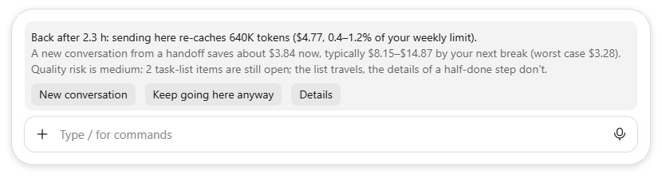

# switch-advisor

A Claude Code plugin, for the terminal and the desktop app's Code tab. It helps when you come back to a large conversation after its prompt cache expired, which happens after an hour idle. Sending there re-caches the whole conversation, at about $8 per million tokens on Opus 5.5.



*The band, shown with the example numbers of `/switch-test demo`.*

## Install

At the prompt of a Claude Code terminal session:

```
/plugin install switch-advisor --marketplace emanuelaviv/claude-usage-monitor
```

Answer `y` to add the marketplace, then pick a scope. From a shell, the same is
`claude plugin install switch-advisor --marketplace emanuelaviv/claude-usage-monitor`. In the desktop app, where
`/plugin` doesn't run: click + next to the prompt box, then Plugins, Add marketplace with
`emanuelaviv/claude-usage-monitor`, then Add plugin. To remove it, run `claude plugin uninstall switch-advisor`,
adding `--scope project` or `--scope local` if you picked that scope (or use `/plugin` in a session), and
`claude plugin marketplace remove claude-usage-monitor` to drop the marketplace too.

**In Cowork.** Cowork loads only the plugins in your Claude account, and none of your local settings. To add it to
your account, open Customize › Plugins in the Claude app, choose Add, then either:

- Add marketplace, with `emanuelaviv/claude-usage-monitor`, then add switch-advisor from it;
- or Upload plugin, and pick a `switch-advisor.plugin` file. `python tools/package_plugin.py` builds one in `dist/`.
  To update it, upload the new file and choose Replace.

It can do less there:
- **Nothing it draws appears in a cloud task**, and new Cowork tasks run in the cloud. A local Cowork task's view
  doesn't show the band, the status line or toasts either (desktop app 4.23118). Its hooks still run.
- **Cowork starts Claude Code anew for each message**, so nothing runs during a break to put the band up for you.
- **The card at submit can show**, as Cowork's question.
- **New conversation leaves the task as it is.** Send `/switch-test restore` in it to get the handoff, with your
  message, and paste that into a new task. Each Cowork task keeps its own plugin store, so a new task can't pick the
  handoff up by itself.
- It shows dollars only and keeps no decision log, as a marketplace install does.

It hasn't been tried in Cowork yet: `/switch-test` in a large task shows the card there, and `/switch-test demo` says
whether the band can be drawn. The account's copy also loads in the Code tab. If you also load the plugin from a folder there
(`CLAUDE_CODE_PLUGIN_DIRS`, below), the account's copy steps back in those sessions, so only one copy acts.

## What it does

- **Status line:** in a conversation of about 160K tokens or more, its size, how long its cache stays warm, and what your next message would cost to re-cache.
- **The band** (pictured): once the cache has expired and a switch would pay, it appears above the prompt by itself, so it's there when you come back. It is never drawn on a phone. Its buttons:
  - **New conversation** makes the first prompt of a new conversation: the handoff, ending with anything you had typed. This conversation stays as it is. See "Switching" below.
  - **Keep going here anyway** hides it until your next break.
  - **Details** opens the full card; its buttons do the same as the band's.
- **The card:** if you send a prompt after a break without answering the band, the plugin checks again with your prompt and asks before it goes out, if a switch still pays. A prompt under 100 characters that names no file counts as a medium quality risk, since it most likely answers Claude's last reply, so it needs a bigger saving. When a switch doesn't pay, your prompt is sent, with a one-line note of the re-cache cost in a conversation of about 230K tokens or more.
  - **New conversation** keeps your prompt out of this conversation and makes the handoff, ending with your prompt, for a new one. See "Switching" below.
  - **Keep going here anyway** sends as usual, and the plugin stays quiet in that conversation for 12 hours.
  - An answer you type under the dialog's Other counts as neither: your prompt is sent as usual, with no quiet period.
  - So does a card you close, one that can't be shown, or one you don't answer within 2 minutes. The card then asks again after your next break. If you answer it after the 2 minutes, it tells you your message has already gone out here and the answer changed nothing. Details and `/switch-test` wait as long as you need, since no message is held; Details answered after its break is over (a turn ran meanwhile) changes nothing, and says so.
- **Switching:** New conversation never clears or changes this conversation. It keeps the handoff for this conversation's project folder (where it started, or where `/cd` or a worktree move took it), even if Claude has since run `cd` into a subfolder:
  - **In the terminal**, the next new conversation you start in that folder within 30 minutes finds the handoff in its box, once, for you to check and send.
  - **In the desktop app's Code tab**, a new session's box belongs to the app until you send its first message, so the plugin can't fill it. Paste the handoff instead: it's on your clipboard. Or send `/switch-test restore` as the new session's first message, which puts it in the box.
  - **In the terminal and the Code tab**, `/clear` in this conversation starts a new one with its handoff in the box, up to 24 hours after the switch. Two things keep it out: Claude replied here after the switch (to you, or to a background task's report), so the handoff doesn't carry that reply; or a new conversation already took it. A note then says which, and `/switch-test restore` puts it in the box anyway. A `/clear` in a conversation that made no handoff takes the newest one kept for the folder within 30 minutes.
  - `/switch-test restore` shows the handoff for 24 hours, to paste anywhere, a new Cowork task included. `/switch-test restore all` lists every handoff kept for the folder, one line each, and `/switch-test restore 2` shows the second of them. What these show is a command's output, which Claude reads with the next message you send in that conversation.
  - Each conversation's handoff is kept apart, so two conversations switching in the same folder don't replace each other's. A second switch in the same break adds your new request to the first handoff. A switch after a later break makes a new one; if the card held a message back before and no new conversation took it, the new handoff carries it too, unless you have sent it here since.
- **When a switch pays:** only after a break long enough for the cache to expire, and only when all of these hold:
  - even in the worst case, where the new conversation re-reads 150K tokens of files, it saves at least $0.50;
  - the typical saving by your next break is at least $2, or $5 when the quality risk is medium or high. With the default numbers on Opus 5.5, that takes a conversation of about 290K tokens, or 455K at medium or high risk;
  - Claude Code didn't already prepare its own summary during the break.
- **Packets:** if you hand work to Claude in task files named `PROMPT_<name>.md` and name the file in your prompt, the card weighs that packet instead. It offers to start the packet in a new conversation only when the packet isn't written for this conversation, isn't a fix or follow-up round of its work (a name ending in, for example, `_fixes`, `_r2` or `_followup`) or one it already worked on, and its file exists and changed in the last 6 hours. Otherwise you get a one-line note instead. Without such files, everything above works the same.
- **What they show:** the saving now, the typical saving and the worst case, and the quality risk, with what the handoff might not carry: an open task list, a question waiting for you, a running workflow, messages that exist only in the chat, a failed test, or many changed files. When the risk is high, the band shows only the saving now and the main reason, and Details shows all of it.
- **When the risk is high,** **Keep going here anyway** comes first, because staying is the safer choice.
- **Demo:** `/switch-test demo` shows the band a 640K-token conversation would get after a 2.3-hour break, with example numbers and nothing from your conversation, for screenshots. It stays up while Claude works. Any of its buttons, `/switch-test off`, or 30 minutes hides it.

## The numbers

- **Dollars are API list-price equivalents** at the session model's prices. On a subscription they measure how much of your limits a choice uses, not what you pay.
- **The 1-hour cache:** it assumes the 1-hour prompt cache that Claude Code uses on subscription plans. If your sessions use the 5-minute cache, its timing and re-cache costs don't fit.
- **"% of your weekly limit"** appears only once you set your rate: run the plugin from a checkout and put `{ "usd_per_pt": [high, low] }` in the checkout's `data/plan.json`, the API-equivalent dollars that 1% of your weekly meter covers. The main README says how to work it out with `python -m monitor.spend`. Without it, the plugin shows dollars only.
- **Defaults:** the fresh-session size, calls between breaks and compaction point are typical values from one heavy user's sessions; run from a checkout, the monitor measures yours. The re-read allowance (80K tokens, 150K in the worst case) stays fixed, and `python -m monitor.verify_estimates` checks it against your sessions.

## What it never does

- call a model;
- send a prompt;
- add text to your prompts;
- ask about slash commands, including skills and built-in commands that ask the model, such as `/init` or
  `/code-review`, or about a prompt with a pasted image or file, which the new conversation's box couldn't take;
- ask about prompts that come over Remote Control from your phone or the web to a session on this computer, that you
  send while a turn is running, that Claude Code marks as ones you didn't see typed (`isMeta`), or that the desktop
  app sends by itself to continue (after a sleep, a quit, a usage limit, a compaction or a restart on a remote host).
  A message relayed from your phone through Cowork's Dispatch, or one in a cloud session, still looks to the plugin
  like one typed at the computer.
- run `/switch-test` over Remote Control from your phone or the web: the handoff it makes is for a new conversation at
  the computer.
- clear, compact or change the conversation you switch away from.

If the card can't be shown or answered within 2 minutes, your prompt is sent as usual. If you chose New conversation,
the handoff, your unsent prompt included, is kept in the plugin's store, and `/switch-test restore` shows it. Where
the surface takes it, it is on your clipboard too. If none of the store, the clipboard or (run from a checkout)
`data/handoffs/` takes it, your prompt is sent here as usual instead, so it is never lost. A handoff from the band's
New conversation is then shown in the conversation (as a notice, not sent to the model), your request first.

## Files it reads and writes

Installed from the marketplace, it writes no files of its own and keeps no log. In your project it runs `git status`, and when a prompt names a `PROMPT_*.md` file, it looks through your project's folder names for that file and reads it. At session start it also reads the variable `CLAUDE_CODE_PLUGIN_DIRS` (with `HOME` or `USERPROFILE`, to expand `~`) and the `.claude-plugin/plugin.json` of each folder it lists, so it can step back when the plugin is also loaded from one of those folders. It keeps its per-conversation state (when Claude last replied, your answers, where it found a packet file) in Claude Code's own plugin store. The store also holds the handoff of each switch, one per conversation, which has conversation text and your unsent prompt in it. A new conversation that takes a handoff, or that you paste it into (your request edited or not), marks it taken, so no other box gets it. A handoff is deleted the first time the plugin starts after it is 24 hours old. In Cowork that is at the task's next message; a task you never go back to keeps it, as it keeps its transcript. The notes of a conversation idle for 30 days are deleted too, up to 50 at each start, so the store never fills up.

Run from a checkout of this repository (see the main README), it also uses the checkout's `data/` folder, which git ignores:

- `switch_decisions/`: every offer and answer, read by the guardrail;
- `handoffs/`: the handoffs you accepted;
- it reads `advisor_params.json` (measured from your sessions), `plan.json` (your weekly-limit rate) and `guardrail.json` (the guardrail's on/off).

Run `python -m monitor.guardrail` in the checkout. It compares conversations started from a handoff with ones that continued in place. If switches start causing more trouble (a correction round, which it recognises from `PROMPT_*.md` names, or going back to the old conversation within a day), or cost more than they save, it turns off the band and the after-break card (not the card for `PROMPT_*.md` packets). They stay off until you set `after_break_enabled` to `true` in `data/guardrail.json`; the guardrail then leaves them on. Deleting the file instead starts it over, so it turns them off again while the switches still meet its rule.

## Turning it off

Installed from the marketplace: `claude plugin disable switch-advisor` turns it off, and `claude plugin uninstall switch-advisor` removes it, adding `--scope project` or `--scope local` if you installed it in that scope (or use `/plugin` in a session, or + and Plugins in the desktop app). Loaded from a checkout: remove its folder from `CLAUDE_CODE_PLUGIN_DIRS` in `~/.claude/settings.json`. If you added it to your Claude account (for Cowork), remove it in Customize › Plugins in the Claude app as well: that copy also loads in the Code tab, and the steps above don't reach it. New sessions then start without it.
